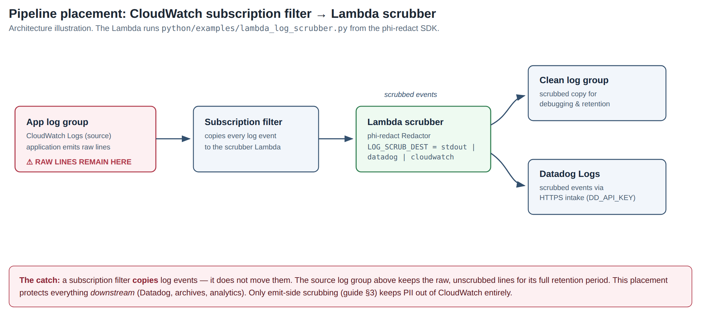
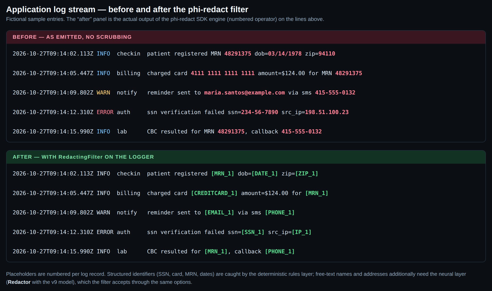
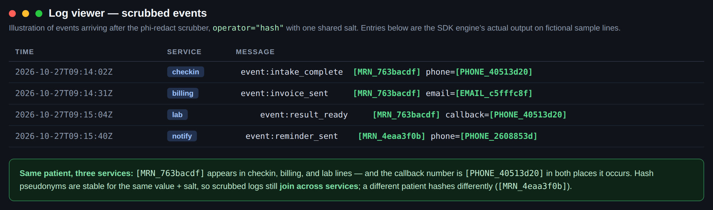

# Logging integrations: CloudWatch Logs and Datadog

Scrub PII/PHI out of application logs with phi-redact — before the lines
are stored, or in the pipeline before they are shipped onward. This
guide covers the two placements that matter, for both AWS CloudWatch
Logs and Datadog:

- **Emit-side**, inside your application, with
  `phi_redact.integrations.logging_kit` (a stdlib `logging` filter and
  a structlog processor).
- **Pipeline-side**, with `python/examples/lambda_log_scrubber.py`, a
  Lambda subscribed to a CloudWatch log group that forwards only
  scrubbed events.

Plus a third, offline option: scrubbing exported log archives with the
batch JSONL processor.

> All sample log lines in this guide and its screenshots are fictional
> (555 numbers, `example.com`, documentation-range IPs). Screenshots
> are local illustrations rendered for this guide — not captures of the
> AWS or Datadog consoles.

## 1. The three placements

| Placement | Where phi-redact runs | PII in the source log store? | Use it when |
|---|---|---|---|
| **Emit-side filter** | Inside the producing process, on every log record before any handler emits it | **No** — lines are scrubbed before they exist anywhere | You control the application code. This is the only placement that satisfies "PII must never be in CloudWatch / Datadog at all." |
| **Pipeline Lambda** | A Lambda subscribed to the source CloudWatch log group; scrubs each batch and forwards to a clean log group or Datadog | **Yes** — raw lines remain in the source log group (see §2) | You cannot change the emitting application, but must protect everything *downstream*: Datadog, archives, analytics, support tooling |
| **Archive scrubbing** | Offline, over exported logs (e.g. CloudWatch exports to S3) with `examples/batch_jsonl.py` | The original export is untouched; you produce a scrubbed copy | One-off or scheduled cleanup before sharing, analysis, or long-term retention of historical logs |

The emit-side filter and the pipeline Lambda compose: filter in the app
for new code, pipeline for the services you cannot touch yet.

## 2. The caveat that decides the placement

**A CloudWatch Logs subscription filter copies log events; it does
not move or alter them.** The source log group stores every raw line
first, and keeps it for its full retention period, regardless of what
any downstream scrubber does.

So pipeline-side scrubbing protects Datadog, your archives, and anyone
with access only to the *clean* log group — but anyone with read access
to the *source* log group still sees raw SSNs, MRNs, and phone numbers.
If your compliance requirement is about the source store itself, only
emit-side scrubbing meets it. Shortening the source group's retention
and restricting its read permissions are worthwhile complements to a
pipeline deployment, not substitutes for emit-side scrubbing.



*Pipeline placement (§3.2 / §4.2). The warning on the source group is
the point: the scrubber sees a copy.*

## 3. CloudWatch Logs

### 3.1 Emit-side: the logging filter

`RedactingFilter` is a standard `logging.Filter`. It renders each
record's message (resolving `%`-style args), scrubs it, and writes the
scrubbed text back before any handler emits the record — so the
destination handler (CloudWatch, Datadog, a file, stdout) needs no
changes at all. By default it also scrubs formatted exception text
(`scrub_exc=True`), which covers identifiers that leak through
tracebacks and error messages. Attach it with `add_redacting_filter`:

```python
import logging

import phi_redact
from phi_redact.integrations.logging_kit import add_redacting_filter

# Rules-only: structured identifiers (SSN, cards, phones, emails,
# dates, MRNs, IPs) are scrubbed with no model files at all.
redactor = phi_redact.Redactor()

# …or with the neural layer, for names and addresses in free text:
redactor = phi_redact.Redactor(
    model="phi-redact-v9-int8.onnx",
    tokenizer="tokenizer.json",
    operator="hash",                 # see §5 for operator choice
    salt="a-secret-shared-by-your-services",
)

logger = logging.getLogger("intake")
add_redacting_filter(logger, redactor)
```

Two placement details of the stdlib `logging` machinery worth knowing:

- Attach the filter to **handlers** if records from child loggers must
  be covered too: a filter on a logger only sees records that logger
  handles directly, while handler filters see everything the handler
  emits, including propagated records.
- The filter mutates the record in place (there is one record object),
  so every handler downstream of it emits the scrubbed version.

**With watchtower** (or any CloudWatch handler): build the handler as
usual, then attach the filter to the handler — scrubbing happens before
watchtower batches and sends anything:

```python
import watchtower

handler = watchtower.CloudWatchLogHandler(log_group="intake-app")
add_redacting_filter(handler, redactor)
logger.addHandler(handler)
```

**In a Lambda function**: the Lambda runtime ships stdout/stderr to
the function's CloudWatch log group automatically, so scrub the root
logger's handler once at module scope and every line the function logs
is scrubbed before the runtime sees it:

```python
import logging

root = logging.getLogger()
for h in root.handlers or [logging.StreamHandler()]:
    add_redacting_filter(h, redactor)
```

**With structlog**: `make_structlog_processor` returns a processor
(duck-typed to structlog's protocol — structlog is not imported) that
scrubs the `event` string and, recursively, every string leaf of
nested dicts/lists/tuples in the event dict. Place it late in the
processor chain, just before your renderer, so it sees the fully
assembled event:

```python
import structlog
from phi_redact.integrations.logging_kit import make_structlog_processor

structlog.configure(processors=[
    structlog.processors.add_log_level,
    structlog.processors.TimeStamper(fmt="iso"),
    make_structlog_processor(redactor),   # scrub last, before rendering
    structlog.processors.JSONRenderer(),
])
```

Note: dict **keys** are not scrubbed — keys are field names chosen by
developers, not data. A key that embeds a raw value (e.g. using an
email address as a field name) is a logging bug to fix at the call
site.



*The same five fictional log lines before and after the filter. The
“after” panel is real output: the lines were passed through
`RedactingFilter` with a rules-only `Redactor` (numbered operator).
Placeholders are numbered per log record.*

### 3.2 Pipeline: subscription filter → Lambda → clean log group

For applications you cannot modify: deploy
`python/examples/lambda_log_scrubber.py` as a Lambda function, grant
CloudWatch Logs permission to invoke it, and create a **subscription
filter** on the source log group with that Lambda as the destination.
Every batch the source group emits is delivered to the function, which
decodes it, scrubs each event's message, and forwards the scrubbed
records. Point downstream consumers at the clean destination, not the
source group — and re-read §2 before calling this done.

With `LOG_SCRUB_DEST=cloudwatch`, the function writes scrubbed events
into `LOG_SCRUB_TARGET_LOG_GROUP` via `PutLogEvents`, one stream per
source stream. The function also needs IAM permission for
`logs:CreateLogStream` and `logs:PutLogEvents` on the target group
(boto3 ships with the Lambda Python runtime; it is not an SDK
dependency). Package the SDK with the function — add the `onnx` extra
and the model files only if you want the neural layer; unset
`PHI_REDACT_MODEL` and the template runs rules-only.

Configuration is entirely environment variables:

| Variable | Required | Meaning |
|---|---|---|
| `LOG_SCRUB_DEST` | no (default `stdout`) | `stdout` \| `datadog` \| `cloudwatch` — see the destination notes below |
| `DD_API_KEY` | for `datadog` | Datadog API key used against the Logs HTTP intake |
| `LOG_SCRUB_TARGET_LOG_GROUP` | for `cloudwatch` | Name of the pre-created clean log group |
| `PHI_REDACT_MODEL` | no | Path to the ONNX model in the deployment package; unset = rules-only |
| `PHI_REDACT_TOKENIZER` | no | Path to `tokenizer.json`, alongside the model |
| `PHI_REDACT_OPERATOR` | no (default `numbered`) | `numbered` \| `label` \| `mask` \| `hash` \| `remove` (see §5) |
| `PHI_REDACT_SALT` | for `hash` | Hash salt — use a secret, shared by every service whose logs must join |
| `PHI_REDACT_THRESHOLD` | no (default `0.6`) | Neural score threshold |

Destination notes:

- `stdout` prints one JSON line per scrubbed event
  (`logGroup`, `logStream`, `timestamp`, `message`) — the Lambda's
  **own** log group becomes the scrubbed store. Zero extra plumbing;
  a good first deployment.
- `cloudwatch` writes to a dedicated clean log group (above).
- `datadog` is §4.2.

Operationally: the Redactor is built once at module load and reused
across invocations, and the handler returns
`{"scrubbed": n, "forwarded": n, "errors": n}` per batch. Each event
is scrubbed under its own error boundary — a message that fails to
scrub is counted in `errors` and **not** forwarded, rather than
forwarded raw. Alarm on `errors > 0`.

### 3.3 Archive scrubbing

For logs already exported (CloudWatch Logs export tasks land in S3 as
text), the 0.4.0 JSONL batch processor produces a scrubbed copy. It
expects one JSON object per line with a `text` field; adapt exports to
that shape first if needed:

```bash
python3 examples/batch_jsonl.py exported.jsonl scrubbed.jsonl \
    --operator hash --salt "$LOG_SALT"
```

The original export is untouched — decide its retention explicitly;
the scrubbed copy is what gets shared and analyzed.

## 4. Datadog

### 4.1 Emit-side

Nothing Datadog-specific is required: scrub before the lines reach
whatever ships them. With the filter attached (§3.1), lines are clean
before the Datadog Agent, a `datadog` handler, or a log-shipping
forwarder ever sees them — and they are equally clean in every other
destination the same logger feeds. Prefer this placement when you can:
it also keeps PII out of any intermediate store, including a local log
file the Agent tails.

### 4.2 Pipeline: subscription filter → Lambda → Datadog

Use the same Lambda template with `LOG_SCRUB_DEST=datadog` and
`DD_API_KEY` set. The function posts scrubbed events to the Datadog
Logs HTTP intake in batches, tagging each entry with its source
`log_group` / `log_stream` (`ddsource` is set to
`phi-redact-log-scrubber`), so Datadog pipelines, facets, and monitors
keep working on the scrubbed stream. The source CloudWatch group caveat
(§2) applies unchanged.



*Scrubbed events as they arrive downstream (illustration; entries are
the SDK engine's actual `hash`-operator output on fictional lines).
The same patient is `[MRN_763bacdf]` in three services' lines — hash
pseudonyms keep scrubbed logs joinable.*

### 4.3 Datadog's Sensitive Data Scanner — an honest comparison

Datadog sells its own redaction feature (Sensitive Data Scanner): a
paid add-on that scans log text against configured rules — regexes and
a library of built-in patterns — and can hash or redact matches,
applied in Datadog's pipeline after ingestion. It is a reasonable
choice when your identifiers are regular and enumerable. Reach for
phi-redact instead when:

- the sensitive content is **clinical free text** — names, addresses,
  and narrative PHI that pattern rules do not express; phi-redact's
  neural layer is a purpose-trained clinical model, and its rules
  layer is checksum-gated (fewer false positives than bare regexes);
- you need scrubbing **before ingestion** — at emit time, or before
  events leave your AWS account — rather than after arrival;
- you want the **same pseudonyms everywhere**: hash tokens are the
  first 8 hex chars of `SHA-256(salt \0 label \0 value)`, identical
  across the Python and TypeScript SDKs, the Lambda, and every service
  that shares the salt — so scrubbed logs still join across services
  and against other scrubbed datasets.

The two also compose: phi-redact at emit/pipeline time, the Scanner as
a downstream safety net for anything that bypassed the scrubber.

## 5. Choosing an operator for logs

The `operator` option (Redactor constructor, or `PHI_REDACT_OPERATOR`
in the Lambda) controls how spans are rendered. For logs:

| Operator | Rendering | Pick it for logs when |
|---|---|---|
| `numbered` (default) | `[SSN_1]`, numbered per record | You need **reversible debugging**: the result's `mapping` ties placeholders back to values. Only safe if the mapping is stored separately from the logs, under tighter access — a mapping next to the logs defeats the scrubbing. In a logging filter the mapping is discarded, so treat numbered log output as irreversible in practice. |
| `hash` | `[MRN_763bacdf]` | **Cross-service correlation** (the Datadog pattern above): same value + same salt → same token in every line, every service, both SDKs. Logs stay joinable; values stay hidden. Use a secret salt — unsalted hashes of low-entropy values (an SSN has ~10⁹ possibilities) are dictionary-attackable. |
| `mask` | `***-**-7890` (last 4 kept for structured IDs) | **Human-readable support logs**: a support engineer can confirm "the card ending 7890" with a customer without the log containing the number. Some risk remains — last-4 plus context can identify — so scope access accordingly. |
| `label` / `remove` | `<SSN>` / *(deleted)* | Maximum minimization; you lose per-value correlation entirely. |

**Review mode in log pipelines.** With `thresholds` /
`review_margin` set on the Redactor, borderline scored spans are not
redacted but returned on `result.review` instead of being silently
dropped. The emit-side filter does not use this (it must emit
*something* for every record), but pipeline and archive processors
can: route records with non-empty `review` to a holding stream or
queue for a human decision, and forward the rest immediately. That
turns "the model was unsure" from a silent leak-or-loss choice into an
explicit queue.

## 6. Performance and failure behavior

- **Measured anchor**: in the October 2026 Presidio comparison, the
  production pipeline (rules + neural) redacted clinical notes at a
  median of **8.4 ms per note** on CPU. Log lines are typically far
  shorter than clinical notes, and the rules layer alone is much
  cheaper than the neural pass — but do not extrapolate a lines/sec
  figure from that anchor. Benchmark on your own log shapes,
  especially before putting the neural layer on a high-volume stream.
- **Reuse one Redactor.** Model load dominates; the filter, the
  Lambda (module-level), and the batch APIs are all designed around a
  single long-lived instance. In the Lambda, each subscription batch
  (up to thousands of events) is scrubbed in the one invocation.
- **For high volume**, prefer the batch path
  (`Redactor.redact_batch` / `redact_iter`, or the JSONL processor)
  over per-line calls, and consider running rules-only: structured
  identifiers are what log lines mostly carry, and the rules layer is
  deterministic with no model to load.
- **Fail-open, by design.** `RedactingFilter` never raises into your
  logging call: if redaction itself fails, the original record passes
  through unchanged — a redaction bug must not take down the
  application's logging. The tradeoff is real: a silent scrubbing
  failure leaks exactly what this kit exists to remove. Mitigate by
  monitoring redaction coverage *outside* the log path (for example,
  sampling traffic and alerting on the Redactor's entity `counts`
  dropping to zero), not by failing log calls. The Lambda template
  makes the mirrored choice: a per-event scrub failure increments
  `errors` and the event is withheld from forwarding, so alarm on
  that count.
- **Cheaper filter mode**: `RedactingFilter(redactor,
  scrub_args=False)` leaves messages entirely alone (only exception
  text is scrubbed) when your log templates are known to embed no
  values and all data travels in structured fields you handle
  elsewhere. Know your call sites before using it.

## See also

- `python/README.md` — operators, allow/deny lists, custom
  recognizers, per-label thresholds and review mode in full.
- `python/examples/batch_jsonl.py` — the archive/batch processor.
- `python/examples/lambda_log_scrubber.py` — the deployable Lambda
  template this guide's pipeline sections describe.
- Disclaimer, as everywhere in this SDK: phi-redact redacts likely
  PII/PHI spans; it is not a certified de-identification method and
  makes no HIPAA Expert Determination or Safe Harbor claim. Validate
  on your own logs before relying on it.
